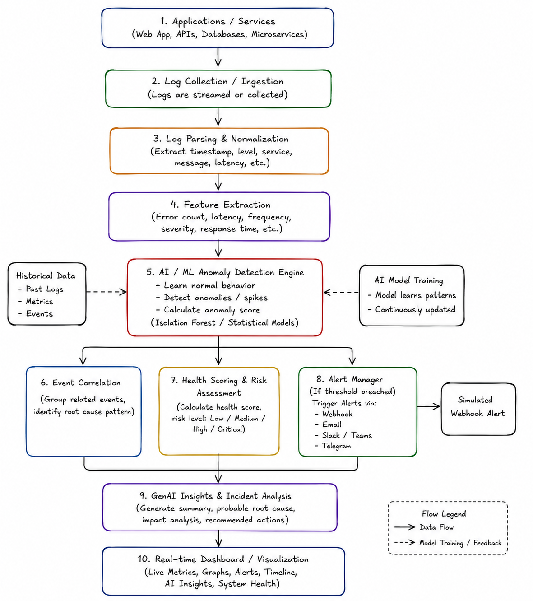

# Prompts

## 2026-05-09 08:18 AM
Lead Architect mode: ON.

We are building a Python-based API-first Intelligent Observability & Event Watchdog system using FastAPI, SQLite, and a future dashboard frontend.

Rules:

* No manual edits. You provide all logic and fixes.
* Maintain a prompts.md file and append every prompt used.
* Goal is an MVP in 4-6 hours.

Phase 1 Requirements:

1. Setup FastAPI backend project structure.
2. Create SQLite database connection using SQLAlchemy.
3. Create a Log model with:

   * id
   * timestamp
   * service
   * level
   * message
4. Build POST /logs endpoint to ingest logs.
5. Build GET /logs endpoint to fetch recent logs.
6. Use clean modular architecture.
7. Add requirements.txt.
8. Add README.md with setup instructions.

Return complete production-style codebase structure.

## 2026-05-09 08:27 AM
Lead Architect mode: ON.

Phase 2 - Intelligent Observability & Detection Engine.

Current backend already supports:

* FastAPI
* SQLite
* SQLAlchemy
* POST /logs
* GET /logs
* Modular architecture

Now extend the Watchdog system into an intelligent observability engine.

OBJECTIVE:
Implement anomaly detection, alerting, health scoring, and AI-style incident insights.

Requirements:

1. Create Alert database model with:

   * id
   * timestamp
   * service
   * severity
   * message
   * anomaly_score

2. Create intelligent anomaly detection service:

   * Analyze recent logs.
   * If ERROR logs exceed threshold:
     Example:

     * More than 5 ERROR logs in last 20 logs
     * OR repeated failures from same service
   * Trigger anomaly detection.

3. Build feature extraction logic:

   * total_logs
   * error_count
   * warning_count
   * info_count
   * logs_per_service
   * error_rate

4. Build health scoring engine:

   * Start health score at 100
   * Reduce based on ERROR frequency
   * Classify system state:

     * Healthy
     * Warning
     * Critical

5. Create automatic alert generation:

   * Save alerts into database.
   * Simulate webhook alerts internally.
   * Add webhook payload structure.

6. Build AI-style incident insight generator:
   Example outputs:

   * "Spike detected in auth-service due to repeated database timeout failures."
   * "Payment-service experiencing elevated error frequency."

   Generate summaries dynamically from logs and alerts.

7. Create new API endpoints:

   * GET /alerts
   * GET /metrics
   * GET /health
   * GET /insights

8. Metrics endpoint should return:

   * total_logs
   * total_errors
   * total_warnings
   * alerts_triggered
   * health_score
   * system_status

9. Maintain clean production-style architecture:

   * services/
   * routes/
   * models/
   * utils/

10. Add sample seed logs for testing anomaly detection.

11. Update:

* prompts.md
* README.md

12. Keep the system lightweight and MVP-focused.
    Avoid unnecessary enterprise complexity.

Return complete updated backend implementation.

## 2026-05-09 08:43 AM
Lead Architect mode: ON.

Phase 3 - Real-Time Observability Dashboard UI.

The backend APIs are already completed and available through FastAPI.

Available endpoints:

* GET /logs
* GET /alerts
* GET /metrics
* GET /health
* GET /insights

OBJECTIVE:
Build a modern AI-powered observability dashboard frontend named "WatchDog".

TECH STACK:

* Next.js (App Router)
* TypeScript
* TailwindCSS
* shadcn/ui
* Recharts
* Lucide React Icons

DESIGN REQUIREMENTS:

* Dark modern observability dashboard
* Premium production-grade feel
* Clean spacing and glassmorphism cards
* Use Instrument Serif font for major headings
* Responsive layout
* Smooth hover effects and subtle animations

DASHBOARD FEATURES:

1. Top Navigation

* App title: WatchDog
* Small status indicator
* Live monitoring badge

2. Metrics Overview Cards
   Display:

* Total Logs
* Total Errors
* Health Score
* Alerts Triggered

Fetch from:

* GET /metrics
* GET /health

3. Live Health Status Panel
   Show:

* System Status
* Health Score
* Error Rate
* Color-coded severity

4. AI Insights Panel
   Fetch from:

* GET /insights

Display AI-generated incident summaries in modern cards.

5. Alerts Section
   Fetch from:

* GET /alerts

Show:

* Severity
* Service
* Alert message
* Timestamp

Use red/orange/yellow severity indicators.

6. Live Logs Table
   Fetch from:

* GET /logs

Display:

* Timestamp
* Service
* Level
* Message

Add:

* colored badges
* scrollable table
* modern styling

7. Analytics Charts
   Using Recharts:

* Error trend chart
* Severity distribution
* Logs per service
* Health trend

8. Auto Refresh
   Refresh dashboard data every few seconds.

9. Architecture
   Create clean frontend structure:

* components/
* services/
* lib/
* app/

10. API Layer
    Centralize backend API calls.

11. Use realistic observability UI inspiration:

* Datadog
* Grafana
* New Relic
* Kibana

12. Keep the frontend MVP-focused but visually impressive.

13. Update prompts.md with this prompt.

Return complete frontend implementation with all components and pages.

## 2026-05-09 08:50 AM
Lead Architect mode: ON.

Fix CORS integration between the FastAPI backend and Next.js frontend.

Current issue:
Frontend running on:

* http://localhost:3000

Backend running on:

* http://127.0.0.1:8000

Browser requests are failing with CORS errors for:

* /metrics
* /health
* /alerts
* /logs
* /insights

Requirements:

1. Add proper FastAPI CORSMiddleware configuration.

2. Allow requests from:

* http://localhost:3000
* http://127.0.0.1:3000

3. Enable:

* allow_credentials
* allow_methods
* allow_headers

4. Keep implementation production-ready and modular.

5. Ensure middleware is added before route registration.

6. Verify all frontend fetch requests work correctly after fix.

7. Update README.md with frontend/backend startup instructions.

8. Update prompts.md with this prompt.

Return the exact backend changes required.

## 2026-05-09 09:01 AM
Lead Architect mode: ON.

Final Phase - Production-Grade README Documentation.

The WatchDog Intelligent Observability & Event Watchdog platform is now fully functional.

Create a world-class README.md for the project.

OBJECTIVE:
The README should feel like a polished open-source AI observability platform repository.

Requirements:

1. Add professional project title:

# WatchDog - Intelligent Observability & Event Watchdog

2. Add a strong project overview section explaining:

* Site Reliability Engineering (SRE)
* AI-powered anomaly detection
* observability
* real-time monitoring
* health scoring
* alerting
* AI incident insights

3. Add architecture diagram section.
   Use:

```md

```

Explain the architecture flow:

* log ingestion
* parsing
* anomaly detection
* alerts
* AI insights
* dashboard visualization

4. Add feature highlights section:

* Real-time observability dashboard
* AI-generated incident insights
* anomaly detection engine
* webhook simulation
* health scoring
* live monitoring
* analytics charts
* alerts system
* service-level telemetry

5. Add frontend technology stack:

* Next.js
* TypeScript
* TailwindCSS
* shadcn/ui
* Recharts

6. Add backend technology stack:

* FastAPI
* SQLite
* SQLAlchemy
* Pydantic

7. Add screenshots section.
   Use markdown image placeholders.

8. Add API endpoints documentation:

* GET /logs
* GET /alerts
* GET /metrics
* GET /health
* GET /insights

Include sample JSON responses.

9. Add setup instructions:
   Backend:

* virtual environment
* pip install
* uvicorn run

Frontend:

* npm install
* npm run dev

10. Add project folder structure.

11. Add observability workflow explanation.

12. Add AI insights explanation.

13. Add future improvements section:

* websocket streaming
* ML anomaly detection
* Slack integration
* Kubernetes monitoring
* distributed tracing

14. Add deployment section:

* Vercel frontend
* Render backend

15. Add author section.

16. Make the README visually impressive:

* badges
* clean markdown formatting
* sections
* emojis
* professional tone

17. Ensure the README feels portfolio-quality and recruiter-friendly.

18. Update prompts.md with this prompt.

Return the complete production-grade README.md.
